# Portfolio design options

Date: 2026-11-16. Four working prototypes of a different design for this site, built so Roy can open them on a preview link and decide whether to replace the pixel-RPG design. Nothing on the live site changes: the options live behind a query switch and are lazy-loaded.

- Chooser: `/?options`
- Options: `/?option=a` (Editorial), `/?option=b` (Console), `/?option=c` (Signal), `/?option=d` (Two modes)
- Current site: `/`

Every option renders the real content of `src/data` (bio, projects, LinkedIn facts). No copy, metric or claim was added. Method for everything below: a production build served with gzip (`scripts/options/serve.mjs`), driven by Playwright and Chromium (`scripts/options/capture.mjs`), plus one run of the `design-critic` agent per page.

## 1. Recommendation

**Switch to option D's structure, and take B's density into it. Do not ship C. Keep A in mind only if you decide the game and the chat are not worth carrying.**

Blunt version:

1. All four options beat the current site on the thing the critique said it loses: restraint, hierarchy and a calm first screen. The critic's pairwise comparison had the current site winning only memorability, against every option. That matches my own read of the captures.
2. The current site's one real advantage is that nobody forgets it. A, B and C throw that away. A recruiter who sees 40 portfolios a week has seen B's look (dark, bento, command palette) and C's look (dark, glowing canvas) many times. They are well made and anonymous.
3. D is the only option that fixes the problem without paying that price. The first screen is a normal professional page (name, role, pitch, resume, email), Roy stands in one framed pixel window, and the game is a button. A recruiter who never presses Play gets a complete page; an engineer who does gets the same Roy Runner as today.
4. D is also the plainest of the four. Its hero has dead space, and its project list is ordinary. It needs B's tighter grid and A's type discipline before it is "premium". As built today, B is the most polished page and D is the best direction.
5. C is the weakest choice. The shader is a real idea (simulated neurons, tied to the degree), but it adds nothing to a hiring decision, it is the heaviest option on a phone, and I could not measure its frame rate on a real GPU from here. The critic ranked it last, below the current site.
6. None of the options is ready to ship. They are not prerendered (the current site is, for SEO and first paint), they load after the main bundle so they are slower on a slow connection than they would be as the real entry, and they have only the shared tests. Section 6 has the work to finish each.

If you decide to keep the current design, that is defensible: it is the most memorable of the five and you already trimmed it. In that case take the four fixes from the new critique of the current site (section 5): one proof line on the first screen, two resume entry points instead of four, stop the desktop chat bubble covering card text, and collapse the side quests.

## 2. Measurements

All from the same production build. "First screen" is what is visible without scrolling. A type style is a distinct font family, size and weight. Interactive elements are links, buttons and inputs. The review chip ("Options", bottom left) is excluded.

{{TABLE}}

How to read the load numbers:

- Slow 3G is DevTools' preset (400 kbit/s, 2 s round trip) on a 375 px phone with an empty cache.
- First contentful paint is the same for all five because it is the static boot card in `index.html`, which every URL gets.
- "Usable" is when the real page is on screen: for the current site the largest contentful paint, for an option the moment it has rendered (a `performance.mark`). The options are about 4 seconds slower here **because of how the prototypes are wired**, not because they are heavy: an option's chunk is requested only after the 113 kB main bundle of the current site has loaded and run. As the real entry point, an option would not load the current site's code at all, and would be prerendered like the current site is.
- "JS added" is what an option adds on top of that main bundle (its own chunk plus the shared options code). The game and the chat are not in these numbers for any page: they load on demand, as they do today.

Bundle check for normal visitors (the site at `/`), before and after this branch: main JavaScript 112,774 to 113,086 bytes gzip (+312 bytes, the route reader), main CSS 15,993 bytes gzip both times (byte-identical, same hash). No option code or font is downloaded on a normal visit.

## 3. Research

Twelve sites were loaded in Playwright, captured at 1440x900 and 390x844 and measured (first-screen words, type styles, interactive elements, page height). The eight that shaped the options:

| Site | Measured first screen (desktop) | What was taken |
|---|---|---|
| brittanychiang.com | 238 words, 10 type styles, 13 interactive, 3,860 px | Whole-row project entries with tech listed under them; an archive table for smaller work (A's and C's index rows) |
| emilkowal.ski | 71 words, 4 type styles, 7 interactive, 1,854 px | One column, no boxes, two-line project rows (A) |
| paco.me, leerob.com | 111 and 132 words, 4 and 5 type styles | Serif text with italic as the only accent; hairline separators; right-aligned meta (A) |
| delba.dev | 182 words, 7 type styles | The hiring ask is the first line of the page (the availability line above the name in every option) |
| linear.app | 145 words, 14 type styles, 9,990 px | Near-black ground, bordered cards, a real product image bleeding off its card (B) |
| zenorocha.com | 32 words, 8 type styles | Command palette with groups ("Go to", actions) and a visible button for touch, since a phone has no Ctrl+K (B) |
| resend.com, lusion.co | 40 and 34 words | The WebGL piece is one object in a framed card beside the text, not a background behind it; no loader (C) |
| ozgurguler.netlify.app | Game view 75 words; professional view 143 words, 6,087 px | The genre peer: a professional page with a thin pixel residue and a "playable version" link (D) |

Also loaded: joshwcomeau.com (one mascot, then plain content), vercel.com (one moving object, everything else still), jahir.dev (per-item `view-transition-name` for list-to-detail morphs, used in A and B). Not verified: bruno-simon.com never rendered in headless Chromium, and no live bento-grid developer portfolio could be reached, so B's bento has no reference beyond product sites.

What recruiters and hiring engineers say they want (career blogs and one HN thread from 2025 and 2026, not primary surveys): title and stack visible without scrolling; the first project card with a screenshot, a one-line outcome and a live link; 3 to 5 projects with a case study for the top 2 or 3; a fast page that works on a phone; "strong project work, not flashy animations". No source said anything about dark mode.

Technique status that decided what was used (from `@mdn/browser-compat-data`, November 2026):

| Technique | Status | Used in | Fallback |
|---|---|---|---|
| Same-document View Transitions | Baseline since October 2025 (Chrome 111, Safari 18, Firefox 144) | A (list to case study), B (tile to dialog), theme toggle | Plain state change; off under reduced motion |
| Scroll-driven animations (`animation-timeline`) | Newly Baseline, October 2026 (Chrome 115, Safari 26, Firefox 159) | A, C (reveals, progress bar) | Inside `@supports`; content is visible by default |
| Container queries, OKLCH, `color-mix()`, `:has()` | Widely available | All four (tokens are OKLCH), B (bento tiles) | None needed |
| `text-wrap: balance / pretty` | Supported in Chrome and Safari; `pretty` not in Firefox | All four | Harmless when ignored |
| Native `<dialog>` | Widely available | B, D | None needed |
| WebGL2 | Widely available, including iOS | C | Static poster on context loss or no WebGL; one still frame under reduced motion |
| WebGPU, anchor positioning, `interpolate-size` | Not Baseline | Not used | - |

New dependencies: fonts only, self-hosted through Fontsource, each loaded only by the option that uses it.

| Package | Used by | Size on the wire | Why |
|---|---|---|---|
| `@fontsource-variable/newsreader` | A | about 80 kB (roman and italic, latin woff2) | The serif the whole option is set in; its optical-size axis keeps the 144 px name and 19 px text in one family |
| `@fontsource-variable/inter` | A, C | about 48 kB | Labels in A, body in C |
| `@fontsource-variable/geist`, `geist-mono` | B | about 60 kB together | The "developer tool" face and its mono |
| `@fontsource-variable/bricolage-grotesque` | C | about 40 kB | Display face |

No JavaScript library was added. Considered and rejected: `three` (186 kB gzip) and `ogl` (34 kB) for C, because a full-screen shader needs about 150 lines of raw WebGL; `cmdk` (17 kB) for B, because a combobox over 15 commands is small to write; `lenis`, because native scrolling is better for accessibility; upgrading `framer-motion` 11 to `motion` 14, because nothing here needs it. D uses the two fonts the site already ships.

## 4. The options

### A - Editorial

**Concept.** Type-led and quiet: the name at 144 px in a serif, one brick-red accent, hairlines instead of boxes. A project opens as a full case-study page through a View Transition, lives in the URL (`#work-<id>`), and the Back button closes it.

| Desktop, light | Desktop, dark | Phone |
|---|---|---|
| 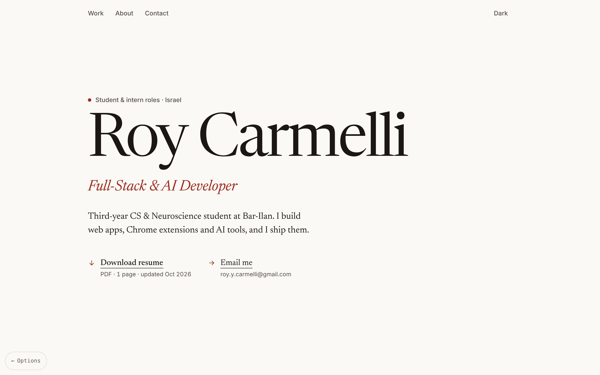 | 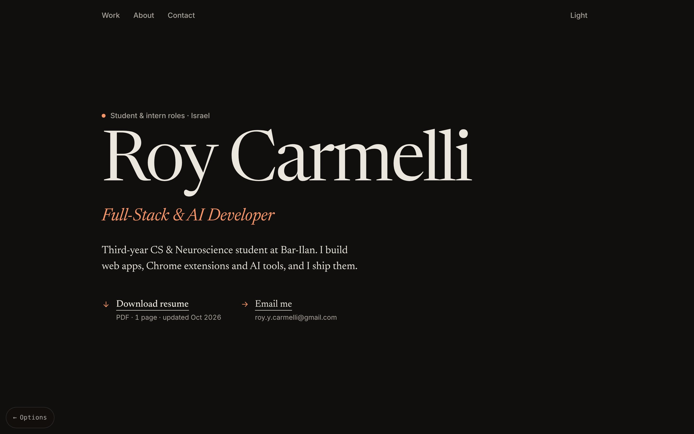 | 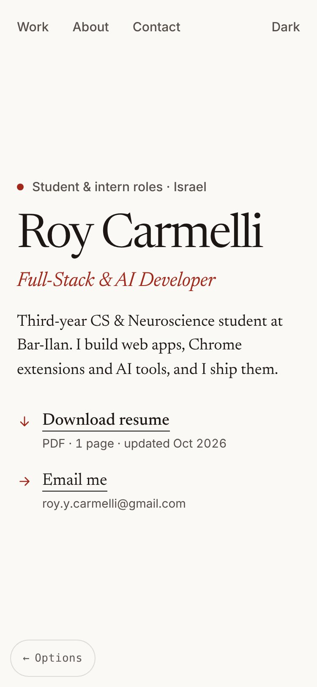 |

Whole page: [desktop](screenshots/a-desktop-full.jpg), [phone](screenshots/a-phone-full.jpg). Tablet: [light](screenshots/a-tablet-light.jpg), [dark](screenshots/a-tablet-dark.jpg). Recordings: [desktop tour](recordings/a-tour-desktop.webm), [phone tour](recordings/a-tour-phone.webm). Critique: [docs/design-review/options/a/CRITIQUE.md](../design-review/options/a/CRITIQUE.md).

- **Better than the current site:** the strongest first screen of the five (the critic: restraint 5 against 2); 6 interactive elements on the first screen against 12; the case studies are the best reading experience for the long project descriptions; the phone page is 35% shorter.
- **Loses:** everything that makes the site Roy's. No game, no chat, no character. The right half of the desktop hero is empty, and the page is as long as the current one on desktop because all twelve projects are listed.
- **Risk with a conservative recruiter:** none. This is the safest option. The risk is the opposite one: it could be anyone's.
- **Fixed after the critique:** the hero now fills the first screen (the next section used to peek in half-faded), a case study ends with the resume and email actions, and Live/Source stay on one row on phones.
- **Work to finish:** about 2 to 3 days. Make it the entry and prerender it (including one page per case study, which would be a real SEO gain), move the SEO tests, decide what happens to the game and the chat, write component tests.

### B - Console

**Concept.** A polished developer tool: near-black ground, a bento grid for projects, education and service, soft depth, and a command palette (Ctrl/Cmd+K, or the search button on a phone) that can go to any section, open any project, download the resume, copy the email or switch theme.

| Desktop, dark | Desktop, light | Phone |
|---|---|---|
| 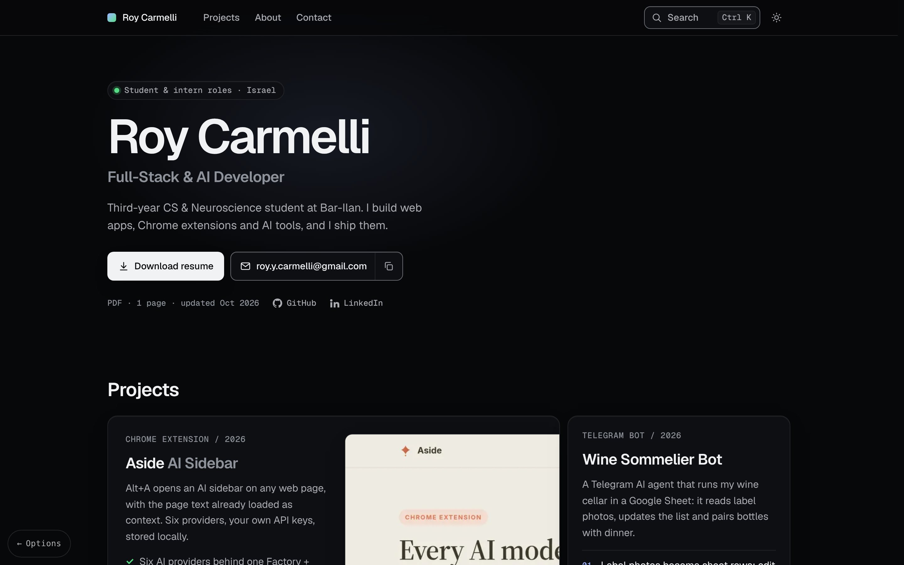 | 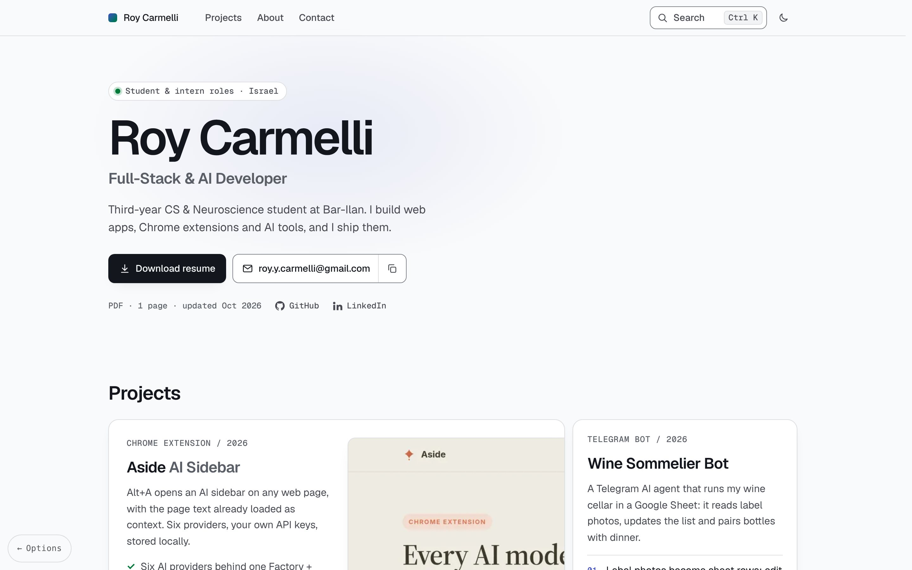 | 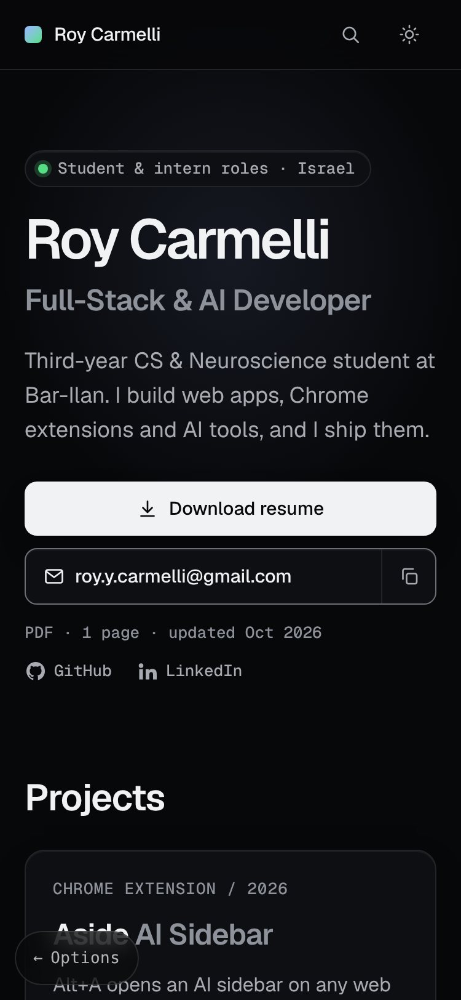 |

Whole page: [desktop](screenshots/b-desktop-full.jpg), [phone](screenshots/b-phone-full.jpg). Tablet: [light](screenshots/b-tablet-light.jpg), [dark](screenshots/b-tablet-dark.jpg). Recordings: [desktop tour](recordings/b-tour-desktop.webm), [phone tour](recordings/b-tour-phone.webm). Critique: [docs/design-review/options/b/CRITIQUE.md](../design-review/options/b/CRITIQUE.md).

- **Better than the current site:** the shortest page by far on desktop (4,419 px against 6,019 px) with the most evidence per screen: the first project tiles start on the first screen; the email is shown and copyable in the hero; the palette is a real demonstration of front-end skill for an engineer who tries it.
- **Loses:** distinctiveness (the critic: 2 against 5) and any image of Roy. It is the most common look of 2026.
- **Risk with a conservative recruiter:** low. Ctrl+K is invisible to a non-developer, but nothing depends on it. The cropped Aside screenshot in its tile reads to some eyes as a clipping bug; it is deliberate and easy to change.
- **Open defects from the critique:** the education and service tiles have empty middles; the right half of the hero is empty.
- **Work to finish:** about 3 to 4 days. Same entry, prerender and SEO work as A, plus tests for the palette and the dialog, and a decision on the game and the chat (a palette command "Play Roy Runner" would fit).

### C - Signal

**Concept.** One WebGL moment: a field of simulated neurons that fire, pass spikes along their connections and light up near the pointer, in a framed card beside the name. Raw WebGL, no library. Below it the page is restrained.

| Desktop, dark | Desktop, light | Phone |
|---|---|---|
| 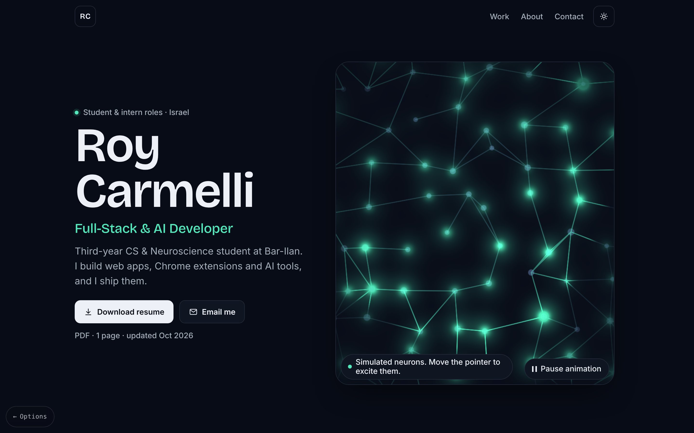 | 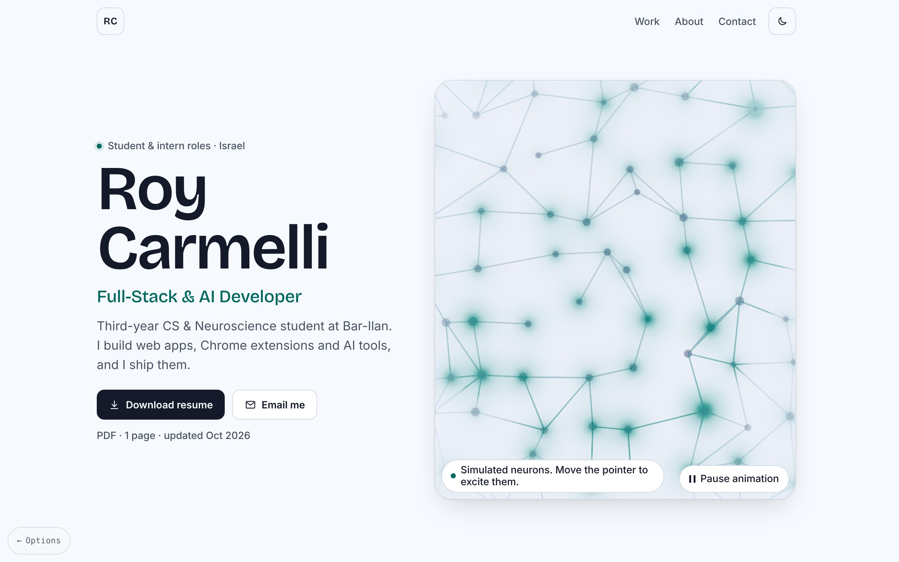 | 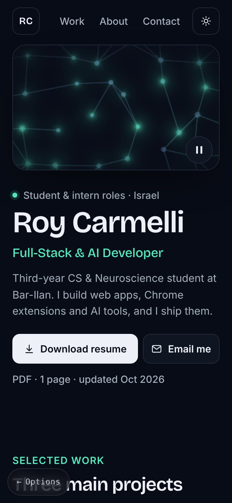 |

Whole page: [desktop](screenshots/c-desktop-full.jpg), [phone](screenshots/c-phone-full.jpg). Tablet: [light](screenshots/c-tablet-light.jpg), [dark](screenshots/c-tablet-dark.jpg). Recordings: [desktop tour](recordings/c-tour-desktop.webm), [phone tour](recordings/c-tour-phone.webm). Critique: [docs/design-review/options/c/CRITIQUE.md](../design-review/options/c/CRITIQUE.md).

- **Better than the current site:** the fewest type styles and words on the first screen; the canvas is the only decoration and it says something true about the degree; it has a pause button, a single still frame under reduced motion and a static fallback.
- **Loses:** the canvas takes the top of the phone screen, so the name starts a third of the way down. The light theme's canvas is washed out. It still reads as "dark developer portfolio with a glowing thing".
- **Risk with a conservative recruiter:** low to medium. It is framed and pausable, but it is the option most likely to be read as showing off.
- **Not measured:** real frame rate. Headless Chromium draws WebGL in software (about 67 ms a frame at reduced resolution here). The shader steps its resolution down and finally freezes to a still if frames stay slow, but it must be tried on a mid-range Android phone before any decision. In the recordings the canvas looks softer than it will on a GPU.
- **Work to finish:** about 3 to 4 days, including real-device testing and battery checks that the others do not need.

### D - Two modes

**Concept.** A clean professional shell that keeps Roy's identity. The pixel world is one framed forest window with Roy in it; Roy Runner is an optional "play mode" (the real game, lazy-loaded into a full-screen dialog), and the Pixel Roy chat stays.

| Desktop, light | Desktop, dark | Phone |
|---|---|---|
| 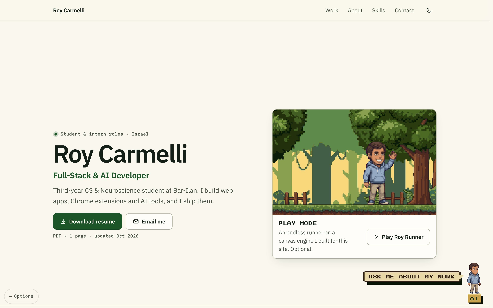 | 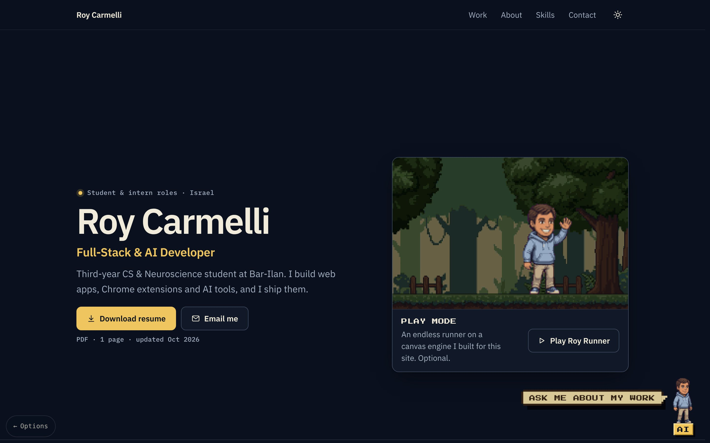 | 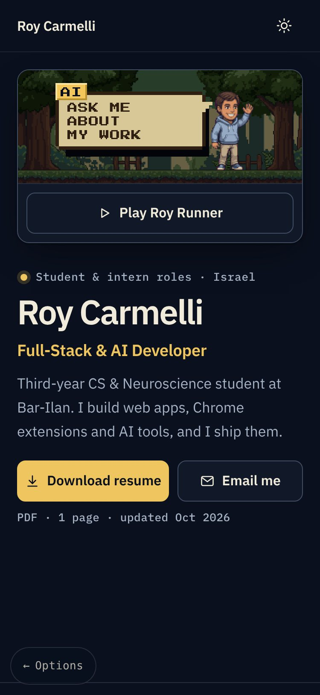 |

Whole page: [desktop](screenshots/d-desktop-full.jpg), [phone](screenshots/d-phone-full.jpg). Tablet: [light](screenshots/d-tablet-light.jpg), [dark](screenshots/d-tablet-dark.jpg). Recordings: [desktop tour](recordings/d-tour-desktop.webm), [phone tour](recordings/d-tour-phone.webm). Critique: [docs/design-review/options/d/CRITIQUE.md](../design-review/options/d/CRITIQUE.md).

- **Better than the current site:** a recruiter sees a normal page first and the game second, instead of the other way round; service and education are plain facts in a side column, not game UI; the phone page is 30% shorter; it adds no fonts and reuses the game and chat code unchanged.
- **Loses:** some distinctiveness (the critic: 3 against 5) and some consistency: the pixel font labels and the chat bubble sit a little oddly on the rounded shell. The hero has dead space on desktop.
- **Risk with a conservative recruiter:** low. The critic: "not put off", with the note that the play card takes half the first screen on desktop.
- **Open defects from the critique:** on a phone the forest window comes before the name (deliberate, so the chat bubble docks beside Roy, but arguable); on a portrait phone "Play Roy Runner" opens the game's "turn your phone sideways" screen, as on the current site; the desktop chat bubble covers card text for its first seconds, also as on the current site.
- **Work to finish:** about 2 to 3 days, the least of the four, because the game, the chat, their tests and most of the SEO pipeline stay as they are. The work is the entry and prerender switch, the hero composition, and removing the old sections.

## 5. Design-critic verdicts

The agent ran once per page against the served build. Its scores cluster around 3 and 4, as expected; its pairwise comparisons and measurements are the useful part. Scores are option / current site.

| Criterion | A | B | C | D |
|---|---|---|---|---|
| Concept and tone fit | 4 / 3 | 4 / 3 | 4 / 3 | 4 / 3 |
| Hierarchy | 4 / 3 | 4 / 3 | 4 / 3 | 4 / 3 |
| Typography | 4 / 3 | 4 / 2 | 4 / 3 | 4 / 3 |
| Colour | 4 / 3 | 4 / 3 | 4 / 3 | 4 / 3 |
| Layout and rhythm | 4 / 3 | 3 / 3 | 4 / 3 | 3 / 3 |
| Restraint | 5 / 2 | 3 / 2 | 4 / 2 | 4 / 2 |
| Consistency | 4 / 4 | 4 / 3 | 4 / 3 | 3 / 4 |
| Imagery | 3 / 4 | 3 / 5 | 4 / 4 | 4 / 4 |
| Motion | 3 / 3 | 4 / 3 | 4 / 3 | 3 / 3 |
| Distinctiveness | 2 / 5 | 2 / 5 | 3 / 4 | 3 / 5 |

Each reviewer scored the current site separately, which is why its number moves between columns: more evidence that the pairwise direction matters and the digits do not.

The fifth run re-critiqued the current site and compared it with all four ([report](../design-review/options/current/CRITIQUE.md)):

- Verdict on the current site: "the most memorable of the five and the best-made pixel portfolio around", but "it still loses the brief's real test, a 30-second skim that ends in hire this person".
- Since the earlier critique, measured again: desktop height unchanged at 6,019 px, phone 12,004 px (was 11,765 px), 12 interactive elements on the desktop first screen (unchanged). The trim made the first screen calmer but did not make the page shorter.
- Pairwise, current against each option: it loses hierarchy, restraint, premium feel and fitness for the brief to all four; it wins memorability against all four; on first impression it loses to A, B and C and beats D.
- Its ranking for this brief: D, B, A, current, C.

Where I disagree with it: it ranks A third as "thinner on proof", but A has the same proof as the others and the best case studies; A's real cost is identity, not evidence. And it calls D's shell "plain" while ranking it first, which is the honest summary of D: the right idea, not yet the best execution.

## 6. If you choose one

Common to all four (about a day and a half of the estimates above): make the option the app's entry instead of a lazy chunk behind the current bundle; render it in `src/entry-server.tsx` so the build prerenders it; keep `src/seo/` output and `seo.test.ts` green (the JSON-LD and llms.txt come from `src/data` and do not change); a new OG image; replace the boot card's pixel look; move or delete the old sections and their tests; update `CLAUDE.md` and `docs/redesign/SPEC.md`.

The options are prototypes: each has the shared tests in `src/options/options.test.tsx` (content rules, landmarks, links, the wording rules) but not the depth of tests the current sections have.

## 7. How this was built and checked

- `src/options/route.ts` reads the query; `src/main.tsx` lazy-loads `src/options/OptionsRoot.tsx` only when it matches. Each option is its own chunk.
- `npm test`: 61 files, 826 tests pass (22 new). `npm run build` passes, including the prerender.
- Every option: no horizontal scroll at 375 px, no tap target under 44 px, no text contrast under 4.5:1 in either theme (computed for every visible text node), body text at least 16 px, visible focus, keyboard reachable, motion off under `prefers-reduced-motion`.
- Captures: `node scripts/options/serve.mjs` then `node scripts/options/capture.mjs` (screenshots at 375x812, 768x1024 and 1440x900 in both themes, whole-page stills, a top-to-bottom recording on desktop and phone, and `metrics.json`).
- Not tested: real phones and real GPUs, Safari and Firefox, screen readers, the chat against a live API (the preview has no chat key unless the project sets one), the leaderboard sign-in inside D.
